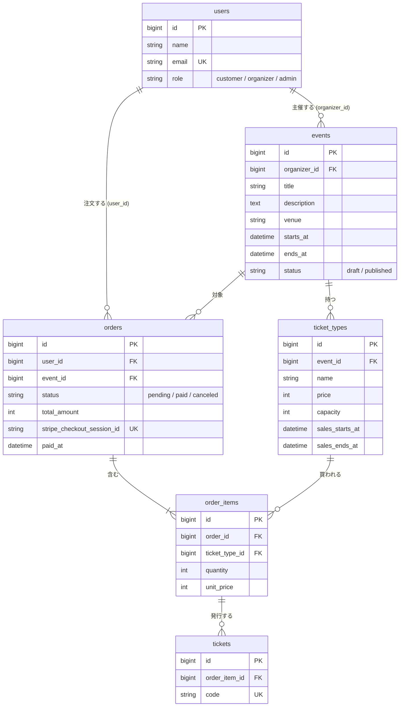

# データベース設計

1回の注文で買えるのは、1つのイベントの券種だけとする（`orders.event_id` を持つ）。

<br>

## ER図



<br>

## カラム定義

全テーブルに `id`（bigint, PK）と `created_at` / `updated_at` がある（表では省略）。

### users（既存テーブルに追加）

| カラム | 型 | 制約 | 説明 |
|-|-|-|-|
| role | string(20) | NOT NULL, default `customer` | `customer` / `organizer` / `admin`。PHP 側は Enum `UserRole` |

### events

| カラム | 型 | 制約 | 説明 |
|-|-|-|-|
| organizer_id | foreignId → users.id | NOT NULL, restrict | 主催者 |
| title | string | NOT NULL | イベント名 |
| description | text | NOT NULL | 説明 |
| venue | string | NOT NULL | 会場 |
| starts_at | datetime | NOT NULL, index | 開始日時。一覧の並び順と「開催済みを除く」判定に使う |
| ends_at | datetime | NULL可 | 終了日時 |
| status | string(20) | NOT NULL, default `draft` | `draft` / `published`。Enum `EventStatus` |

- インデックス: `(status, starts_at)`（公開イベント一覧の検索用）

### ticket_types

| カラム | 型 | 制約 | 説明 |
|-|-|-|-|
| event_id | foreignId → events.id | NOT NULL, cascade | どのイベントの券種か |
| name | string | NOT NULL | 券種名（一般、学生など） |
| price | unsignedInteger | NOT NULL | 価格（円）。0円も可 |
| capacity | unsignedInteger | NOT NULL | 定員 |
| sales_starts_at | datetime | NOT NULL | 販売開始日時 |
| sales_ends_at | datetime | NOT NULL | 販売終了日時。開始より後であることはバリデーションで確認する |

- 残り枚数は列で持たず計算する（[残り枚数の計算](#残り枚数の計算)）

### orders

| カラム | 型 | 制約 | 説明 |
|-|-|-|-|
| user_id | foreignId → users.id | NOT NULL, restrict | 注文者 |
| event_id | foreignId → events.id | NOT NULL, restrict | 対象のイベント |
| status | string(20) | NOT NULL, default `pending`, index | `pending`（支払い待ち）/ `paid`（支払い済み）/ `canceled`（中断・期限切れ）。Enum `OrderStatus` |
| total_amount | unsignedInteger | NOT NULL | 合計金額（円）。明細から計算し、注文時に保存する |
| stripe_checkout_session_id | string | NULL可, unique | Checkout Session の ID。Day4 は NULL、平日課題で保存する |
| paid_at | datetime | NULL可 | 支払いが確定した日時（Webhook で設定） |

### order_items

| カラム | 型 | 制約 | 説明 |
|-|-|-|-|
| order_id | foreignId → orders.id | NOT NULL, cascade | 注文 |
| ticket_type_id | foreignId → ticket_types.id | NOT NULL, restrict | 券種 |
| quantity | unsignedInteger | NOT NULL | 枚数（1以上） |
| unit_price | unsignedInteger | NOT NULL | 注文時点の単価（円） |

- ユニーク制約: `(order_id, ticket_type_id)`（1つの注文で同じ券種は1行にまとめる）

### tickets

| カラム | 型 | 制約 | 説明 |
|-|-|-|-|
| order_item_id | foreignId → order_items.id | NOT NULL, cascade | どの明細から発行されたか |
| code | string(32) | NOT NULL, unique | チケットごとの固有コード。推測されにくいランダムな文字列（例: `Str::random(16)`） |

<br>

## 残り枚数の計算

券種ごとに、次の式で計算する。

```
残り枚数 = ticket_types.capacity − 確保済みの枚数
確保済みの枚数 = その券種の order_items.quantity の合計（orders.status が pending または paid のものだけ）
```

- `pending`（支払い待ち）も数える。数えないと、支払いが終わる前に同じ枠が他の人にも売れてしまう
- `canceled`（中断・期限切れ）は数えない。キャンセルされると枠が戻る
- 結果が0以下なら「売り切れ」と表示する（表示は0で止める）

SQL で書くと次のとおり。

```sql
SELECT
    tt.id,
    tt.capacity - COALESCE(SUM(CASE WHEN o.status IN ('pending', 'paid') THEN oi.quantity ELSE 0 END), 0) AS remaining
FROM ticket_types tt
LEFT JOIN order_items oi ON oi.ticket_type_id = tt.id
LEFT JOIN orders o ON o.id = oi.order_id
WHERE tt.event_id = ?
GROUP BY tt.id, tt.capacity;
```

Eloquent では `withSum` で確保済みの枚数を一緒に取ると、券種ごとにクエリを投げずに済む。

```php
$event->ticketTypes()
    ->withSum(['orderItems as reserved_quantity' => function ($query) {
        $query->whereHas('order', fn ($query) => $query->whereIn('status', ['pending', 'paid']));
    }], 'quantity')
    ->get();
// 残り枚数 = $ticketType->capacity - (int) $ticketType->reserved_quantity
```

### 使う場面

| 場面 | 使い方 |
|-|-|
| イベント詳細（C4） | 券種ごとに残り枚数を表示する。0なら「売り切れ」 |
| 注文の作成（C8, C9） | 選んだ枚数が残り枚数以下か確認する。超えていたらエラーを表示し、注文を作らない |
| 中断・期限切れ（C13, 平日） | 注文を `canceled` にすると、次の計算から自動で枠が戻る |

- 同時に注文が来たときの売り越し対策（トランザクションと行ロック）は拡張 E2 で扱う

<br>

## 外部キーの削除時の動き

方針: お金の記録（注文）は消させない。

| 外部キー | 削除時 | 理由 |
|-|-|-|
| events.organizer_id | restrict | イベントを持つ主催者を消すと、注文の記録まで消えるため |
| ticket_types.event_id | cascade | 券種はイベントの一部。注文がまだ無いイベントなら券種ごと消してよい |
| orders.user_id | restrict | 支払いの記録を残すため |
| orders.event_id | restrict | 注文があるイベントは削除できなくする |
| order_items.order_id | cascade | 明細は注文の一部 |
| order_items.ticket_type_id | restrict | 売れた券種は削除できなくする。どの券種か分からなくなるため |
| tickets.order_item_id | cascade | チケットは明細の一部 |

<br>

## 実装で気をつけること

- 注文があるイベントや券種を削除しようとすると DB エラーになる。画面側で先に注文の有無を確認し、「注文があるため削除できません」と出す
- スターターキットのアカウント削除も、主催者や注文済みのユーザーだと DB エラーになる。削除前の確認を入れるか、削除の機能を外すかを決める
- 支払い待ちの注文も残り枚数から引く（支払い前の売り越しを防ぐ）。中断ページ（C13）や Checkout Session の期限切れの Webhook で `canceled` にして枠を戻す
- 画像（E14）とチェックイン日時（E1）の列は、拡張のときに追加する
